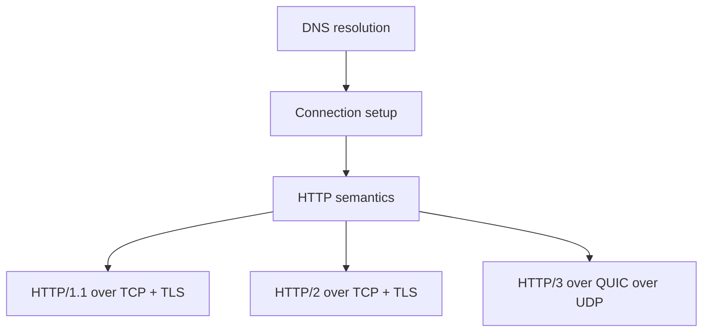

# Networking: HTTP/1.1 vs 2 vs 3, TCP/UDP, DNS, TLS/HTTPS, WebSocket, SSE

> Mức độ: ⭐⭐⭐ senior | Thời gian đọc: ~10 phút

## 1. Tóm tắt nhanh (TL;DR)

- DNS ánh xạ tên miền sang địa chỉ; TCP cung cấp byte stream có thứ tự/retransmission; UDP datagram nhẹ hơn nhưng không bảo đảm delivery/order.
- TLS xác thực server (và tùy cấu hình client), mã hóa và bảo vệ integrity; HTTPS là HTTP qua TLS.
- HTTP/1.1 thường dùng nhiều connection để tăng concurrency; HTTP/2 multiplex nhiều stream trên một TCP connection nhưng TCP packet loss có thể ảnh hưởng toàn connection.
- HTTP/3 chạy HTTP semantics trên QUIC/UDP, có stream-level loss handling và TLS 1.3 tích hợp; không có nghĩa UDP tự đảm bảo delivery.
- WebSocket là kênh hai chiều lâu dài; SSE là server-to-client stream qua HTTP; polling đơn giản hơn nhưng có chi phí lặp.

## 2. Khái niệm cốt lõi

Khi client gọi `https://api.example.com`, resolver tra DNS records (cache có TTL), lấy IP, rồi thiết lập transport connection (TCP cho HTTP/1.1 và HTTP/2; QUIC cho HTTP/3). Với TCP, three-way handshake tạo kết nối đáng tin cậy, có thứ tự; TLS handshake thương lượng cipher, xác thực certificate/hostname và tạo session keys. TLS có thể được tái sử dụng/resumed; proxy/load balancer có thể kết thúc TLS tại một hop, nên trust boundary cần rõ.

HTTP là application protocol, độc lập với business semantics. HTTP/1.1 dùng text-based messages, persistent connections và có thể gặp head-of-line blocking ở tầng request/response trên một connection; clients thường mở nhiều connections. HTTP/2 dùng binary framing, multiplex streams và HPACK header compression. Tuy nhiên, các stream chung một TCP connection, nên packet loss làm TCP chờ retransmission trước khi giao byte tiếp theo (transport-level head-of-line blocking).

HTTP/3 dùng QUIC trên UDP. QUIC cung cấp reliability, congestion control, stream multiplexing và TLS 1.3; loss ở một stream không nhất thiết chặn delivery của stream khác. UDP chỉ là nền datagram, phần reliability/crypto do QUIC đảm nhiệm. Hỗ trợ mạng/proxy, connection migration và deployment thực tế vẫn cần kiểm tra.



WebSocket qua HTTP/1.1 dùng Upgrade handshake; qua HTTP/2 và HTTP/3 có thể dùng extended CONNECT trên một stream khi hai phía hỗ trợ (RFC 8441/9220). Sau handshake, WebSocket cung cấp kênh full-duplex; phù hợp chat/collaboration cần client và server gửi chủ động. SSE giữ HTTP response mở, server gửi event dạng text theo một chiều, browser tự reconnect; phù hợp notification/feed. Cả hai cần heartbeat, reconnect/backoff, authorization, load balancer timeout và chiến lược scale nhiều instance.

## 3. Code ví dụ

Ví dụ SSE server tối giản bằng Node.js 22+. Production cần xác thực, giới hạn connection, heartbeat và xử lý backpressure.

```js
import { createServer } from 'node:http';

const server = createServer((request, response) => {
	if (request.url !== '/events') {
		response.writeHead(404).end();
		return;
	}

	response.writeHead(200, {
		'Content-Type': 'text/event-stream; charset=utf-8',
		'Cache-Control': 'no-cache',
		Connection: 'keep-alive',
	});

	response.flushHeaders();
	let timer;
	const resume = () => {
		timer = setInterval(sendEvent, 1000);
	};
	const sendEvent = () => {
		if (!response.write(`data: ${JSON.stringify({ time: Date.now() })}\n\n`)) {
			clearInterval(timer);
			response.once('drain', resume);
		}
	};

	timer = setInterval(sendEvent, 1000);
	response.on('close', () => {
		clearInterval(timer);
		response.off('drain', resume);
	});
});

server.listen(3000);
```

## 4. Trade-off & Best practices

- Dùng keep-alive/connection pooling để giảm handshake overhead; giới hạn pool để không làm cạn file descriptors hoặc downstream connection capacity.
- Chọn HTTP version theo client, CDN/proxy và workload; đo latency/throughput trong môi trường triển khai. HTTP/2 không tự làm mọi API nhanh hơn.
- WebSocket phù hợp hai chiều liên tục; SSE đơn giản hơn cho server-to-client; polling hợp use case ít cập nhật hoặc cần fallback đơn giản.
- Đặt timeout cho DNS, connect, TLS, request và idle connection; retry chỉ khi method/operation idempotent hoặc có idempotency key.
- TLS certificate validation phải bật; quản lý certificate rotation và không tắt verification để “sửa” lỗi môi trường.
- Với realtime, định nghĩa reconnect, event ID/replay, ordering, duplicate handling và fan-out qua nhiều server.

## 5. Lỗi thường gặp / Pitfalls

- Nhầm TCP connection với HTTP request; một connection có thể phục vụ nhiều request/stream tùy protocol.
- Cho rằng HTTP/2 loại bỏ mọi head-of-line blocking; multiplexing không khắc phục TCP-level packet loss.
- Nghĩ UDP nhanh hơn TCP trong mọi trường hợp hoặc tự cung cấp reliability; ứng dụng phải định nghĩa semantics hoặc dùng protocol như QUIC.
- Không đặt timeout/giới hạn connection, để client chậm giữ socket và memory vô hạn.
- Dùng WebSocket/SSE nhưng quên auth khi reconnect, load balancer idle timeout, heartbeat và cleanup.
- Retry POST không idempotent sau timeout khi server có thể đã thực hiện side effect.

## 6. Câu hỏi phỏng vấn

<details>
<summary><b>Q1. HTTP/2 multiplexing cải thiện điều gì, còn giới hạn nào?</b></summary>

Cho nhiều stream cùng một connection, giảm connection overhead và application-level blocking. Vì chạy trên TCP, packet loss vẫn có thể chặn delivery byte cho các stream khác trên connection.

</details>

<details>
<summary><b>Q2. QUIC khác “HTTP/3 trên UDP” ở điểm nào?</b></summary>

QUIC là transport protocol trên UDP tự triển khai reliability, congestion control, stream multiplexing và TLS 1.3. UDP chỉ cung cấp datagram substrate, không tự bảo đảm các tính chất đó.

</details>

<details>
<summary><b>Q3. Khi nào chọn WebSocket, SSE hay polling?</b></summary>

WebSocket cho giao tiếp hai chiều thường xuyên; SSE cho server-to-client event stream; polling cho cập nhật thưa, client đơn giản hoặc khi cần fallback dễ vận hành.

</details>

<details>
<summary><b>Q4. TLS đảm bảo những gì?</b></summary>

Mã hóa, integrity và xác thực peer theo certificate/configuration. TLS không thay authorization, validation hoặc bảo vệ dữ liệu đã bị lộ ở endpoint.

</details>

<details>
<summary><b>Q5. DNS TTL có nghĩa client luôn cập nhật IP đúng TTL?</b></summary>

Không tuyệt đối. Resolver/client có thể cache theo policy riêng; propagation và negative caching cũng ảnh hưởng. Thiết kế failover cần tính tới cache và connection đang mở.

</details>

<details>
<summary><b>Q6. Vì sao timeout và idempotency quan trọng với network calls?</b></summary>

Network có thể chậm/mất response sau khi server đã xử lý. Timeout giới hạn tài nguyên; idempotency key hoặc operation semantics giúp retry không tạo side effect trùng.

</details>

## 7. Ứng dụng vào CV

- Thiết kế SSE/WebSocket reconnect và fan-out cho **[N]** kết nối đồng thời, giảm latency cập nhật từ **[A] giây xuống [B] ms**.
- Tối ưu connection pooling, timeout và retry policy cho **[service/API]**, giảm p95 request latency **[A]%** và lỗi socket timeout **[B]%**.

## 8. Tài liệu tham khảo

- [MDN: HTTP overview](https://developer.mozilla.org/en-US/docs/Web/HTTP/Overview)
- [RFC 9113: HTTP/2](https://www.rfc-editor.org/rfc/rfc9113)
- [RFC 9114: HTTP/3](https://www.rfc-editor.org/rfc/rfc9114)
- [RFC 9000: QUIC](https://www.rfc-editor.org/rfc/rfc9000)
- [MDN: Server-Sent Events](https://developer.mozilla.org/en-US/docs/Web/API/Server-sent_events)


- [WHATWG: Server-sent events — framing bằng dòng trống](https://html.spec.whatwg.org/multipage/server-sent-events.html)
- [Node.js HTTP: ServerResponse close](https://nodejs.org/api/http.html#event-close_2)
- [RFC 8441: WebSockets over HTTP/2](https://www.rfc-editor.org/rfc/rfc8441)
- [RFC 9220: WebSockets over HTTP/3](https://www.rfc-editor.org/rfc/rfc9220)
