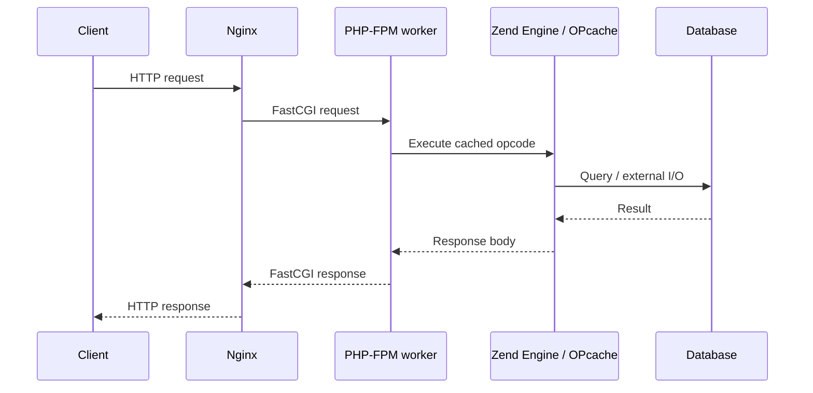

# Cơ chế chạy PHP: Zend Engine, OPcache, PHP-FPM, request lifecycle, shared-nothing

> Mức độ: ⭐⭐⭐ senior | Thời gian đọc: ~9 phút

## 1. Tóm tắt nhanh (TL;DR)

- PHP source được parse/compile thành opcode; Zend Engine thực thi opcode và quản lý runtime values, stack/frame cùng memory.
- OPcache giữ opcode đã compile trong shared memory để tránh parse/compile lại mỗi request; production thường tắt timestamp validation hoặc dùng deployment invalidation có kiểm soát.
- PHP-FPM quản lý pool worker process nhận FastCGI request; mỗi worker xử lý request, không phải một thread PHP dùng chung toàn bộ app state.
- Shared-nothing của request model giúp cô lập state giữa request, nhưng connection, file, cache, database và external side effects vẫn có lifecycle riêng.
- Tối ưu phải đo queue time, worker saturation, DB/network latency, memory per worker và OPcache hit rate; tăng worker không chữa bottleneck downstream.

## 2. Khái niệm cốt lõi

Ở mức khái quát, PHP source được lexer/parser biến thành abstract syntax tree, compiler phát opcode, rồi Zend VM thực thi. Với OPcache bật, opcode được lưu trong shared memory để process worker tái sử dụng; engine vẫn phải thực hiện runtime work cho từng request. OPcache không cache kết quả HTTP hay query. Opcache file cache có thể hỗ trợ cache opcode qua restart tùy cấu hình, khác shared memory runtime.

PHP-FPM có master process quản lý worker pool. Web server như Nginx chuyển request qua FastCGI; worker lấy script, chạy lifecycle bootstrap/request, phát response rồi quay lại chờ request tiếp. Các mode `static`, `dynamic`, `ondemand` cân bằng startup/idle memory với khả năng scale. Một worker xử lý một request tại một thời điểm; tổng concurrency bị giới hạn bởi workers và tài nguyên downstream.



“Shared-nothing” thường mô tả request state không mặc định sống sang request khác. Nó giảm rủi ro state leakage nhưng không có nghĩa process không giữ tài nguyên: OPcache là shared memory, DB connection/persistent resource có thể tồn tại, APCu có process-local/shared segment tùy setup. PHP worker có giới hạn `pm.max_requests` để recycle process định kỳ, hữu ích với memory growth từ extension/library, nhưng không thay việc tìm leak.

## 3. Code ví dụ

Quan sát số script cached, memory và hit rate bằng `opcache_get_status` (không trực tiếp đo thời gian compile/run); hàm có thể trả `false` nếu OPcache chưa bật hoặc status bị giới hạn. Không dùng code này làm endpoint công khai.

```php
<?php
declare(strict_types=1);

$status = function_exists('opcache_get_status') ? opcache_get_status(false) : false;

if ($status === false) {
		echo "OPcache is unavailable or disabled", PHP_EOL;
		exit(0);
}

$memory = $status['memory_usage'];
printf(
		"Cached scripts: %d; used memory: %d bytes; hit rate: %.2f%%\n",
		$status['opcache_statistics']['num_cached_scripts'],
		$memory['used_memory'],
		$status['opcache_statistics']['opcache_hit_rate'],
);
```

## 4. Trade-off & Best practices

- Production: bật OPcache, cấu hình memory/file limits theo codebase, kiểm tra restart/invalidation trong deploy; `opcache.validate_timestamps=0` chỉ an toàn khi deploy có cơ chế reset/restart đúng.
- Cấu hình FPM pool theo memory budget: ước tính worker RSS/peak × `pm.max_children`, chừa tài nguyên OS, web server, sidecar và cache.
- Theo dõi `listen queue`, active/idle workers, `max children reached`, request duration, slowlog và upstream timeout; mỗi metric chỉ ra lớp bottleneck khác nhau.
- Dùng FPM slowlog để lấy stack của request chậm, không chỉ tăng timeout. Kiểm tra SQL, external API và lock contention trước khi thêm worker.
- Set `pm.max_requests` dựa trên memory behavior và thời gian recycle; recycle quá thấp tăng process startup, quá cao có thể để memory creep tích lũy.
- Giữ state request-scoped trong request; dùng session/cache/DB cho state cần tồn tại, có TTL/consistency rõ.

## 5. Lỗi thường gặp / Pitfalls

- Nhầm OPcache với application/data cache hoặc kỳ vọng nó làm query nhanh hơn.
- Tắt timestamp validation nhưng deploy không reset OPcache, khiến worker tiếp tục chạy code cũ.
- Đặt `pm.max_children` theo số CPU mà quên memory mỗi worker và connection limits của DB.
- Thấy FPM queue nên tăng worker, vô tình làm DB quá tải và tăng tail latency.
- Nghĩ shared-nothing nghĩa không thể có memory leak hoặc persistent connection.
- Dùng `phpinfo()`/OPcache status endpoint công khai làm lộ cấu hình nội bộ.

## 6. Câu hỏi phỏng vấn

<details>
<summary><b>Q1. OPcache cải thiện phần nào?</b></summary>

OPcache lưu opcode đã compile trong shared memory để tránh parse/compile lặp lại. Nó không cache kết quả query/response và không loại bỏ thời gian thực thi logic mỗi request.

</details>

<details>
<summary><b>Q2. PHP-FPM worker xử lý concurrency thế nào?</b></summary>

Master quản lý pool process; mỗi worker thường xử lý một request tại một thời điểm. Pool size giới hạn concurrency và phải cân bằng CPU, memory, DB connections.

</details>

<details>
<summary><b>Q3. Khi nào `pm.max_children` quá cao?</b></summary>

Khi tổng RSS vượt memory budget, CPU context switching tăng hoặc worker tạo nhiều DB connections vượt capacity. Theo dõi queue cùng downstream latency trước khi tăng.

</details>

<details>
<summary><b>Q4. `opcache.validate_timestamps=0` có trade-off gì?</b></summary>

Giảm kiểm tra file timestamp nhưng code mới có thể chưa được nhận nếu không reset/restart OPcache. Deployment phải bảo đảm invalidation/worker restart atomic và có rollback.

</details>

<details>
<summary><b>Q5. `pm.max_requests` giải quyết điều gì?</b></summary>

Recycle worker sau số request định trước để giới hạn memory growth do leak/extension fragmentation. Nó là guardrail vận hành, không sửa root cause.

</details>

<details>
<summary><b>Q6. Vì sao shared-nothing hữu ích?</b></summary>

Request không phụ thuộc mutable memory từ request trước, giúp isolation và scale process dễ hơn. State bền phải externalize và thiết kế consistency/TTL rõ ràng.

</details>

## 7. Ứng dụng vào CV

- Tuning PHP-FPM pool và OPcache dựa trên RSS/queue/slowlog, tăng throughput **[A]%** trong memory budget **[B] GB**.
- Rút ngắn p95 response từ **[A] ms xuống [B] ms** bằng profiling request lifecycle và xử lý bottleneck SQL/API thay vì tăng worker mù quáng.

## 8. Tài liệu tham khảo

- [PHP-FPM configuration](https://www.php.net/manual/en/install.fpm.configuration.php)
- [PHP OPcache](https://www.php.net/manual/en/book.opcache.php)
- [PHP Internals Book](https://www.phpinternalsbook.com/)
- [Nginx: FastCGI module](https://nginx.org/en/docs/http/ngx_http_fastcgi_module.html)

