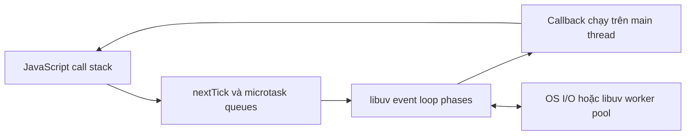

# Event loop chi tiết (phases, microtask vs macrotask, process.nextTick, setImmediate)

> Mức độ: ⭐⭐⭐ senior | Thời gian đọc: ~8 phút

## 1. Tóm tắt nhanh (TL;DR)

- JavaScript trong một isolate Node.js thực thi trên một main thread; event loop điều phối callback, không biến mọi công việc thành song song.
- I/O thường được giao cho hệ điều hành hoặc libuv; callback được đưa lại vào loop khi hoàn tất.
- Vòng lặp libuv có các phase như timers, pending callbacks, poll, check và close callbacks. Thứ tự quan sát được còn phụ thuộc thời điểm callback được lập lịch.
- Promise jobs (microtasks) chạy sau đoạn JavaScript hiện tại; `process.nextTick()` có hàng đợi riêng được ưu tiên cao hơn, vì vậy dùng đệ quy có thể làm đói event loop.
- `setImmediate()` chạy ở phase check; `setTimeout(fn, 0)` chỉ đặt ngưỡng thời gian tối thiểu, không bảo đảm chạy ngay.

## 2. Khái niệm cốt lõi

Node.js không có một event loop duy nhất theo nghĩa toàn bộ runtime chỉ gồm một thành phần. V8 thực thi JavaScript trên một thread của mỗi isolate; Node.js gắn runtime này với libuv để xử lý I/O, timer và điều phối callback. Có thể hình dung luồng chính như sau:



Khi gọi API bất đồng bộ, phần JavaScript đăng ký công việc rồi tiếp tục chạy. Với socket I/O, libuv thường dựa vào cơ chế multiplexing của hệ điều hành. Một số API như `fs`, `crypto`, `zlib` có thể dùng thread pool libuv; DNS lookup có thể thuộc nhóm này tùy API. Khi hoàn tất, callback được đưa vào hàng đợi phù hợp. Callback vẫn chạy trên main thread nên một callback tính toán lâu sẽ chặn request khác.

Các phase chính theo thứ tự khái quát:

1. **timers**: chạy callback của `setTimeout`/`setInterval` đã đủ điều kiện theo ngưỡng thời gian.
2. **pending callbacks**: một số callback I/O bị trì hoãn từ vòng trước.
3. **idle/prepare**: nội bộ libuv.
4. **poll**: lấy sự kiện I/O mới và chạy callback I/O; có thể chờ nếu không có việc phù hợp.
5. **check**: chạy callback `setImmediate`.
6. **close callbacks**: ví dụ callback đóng socket.

Sau khi callback JavaScript kết thúc, Node xử lý hàng đợi `nextTick` và microtasks trước khi chuyển tiếp theo. Microtasks bao gồm reaction của Promise và `queueMicrotask`. Thứ tự cụ thể giữa phase và microtask có chi tiết phụ thuộc phiên bản, nhưng không nên dùng các chi tiết đó làm giao kèo ứng dụng. Từ Node 20/libuv 1.45, timer được xử lý theo thay đổi liên quan đến vòng lặp sau poll; do đó bài kiểm tra thứ tự `setTimeout(0)` và `setImmediate()` ở top-level không nên kỳ vọng một thứ tự cố định. Bên trong callback I/O, `setImmediate` thường được chạy trước timer mới đủ điều kiện.

## 3. Code ví dụ

Ví dụ Node 22 minh họa thứ tự đồng bộ, `nextTick`, Promise và callback ở phase khác nhau. Không khẳng định thứ tự giữa hai timer/check được tạo từ top-level.

```js
import { readFile } from 'node:fs';

console.log('sync');
process.nextTick(() => console.log('nextTick'));
queueMicrotask(() => console.log('microtask'));
Promise.resolve().then(() => console.log('promise'));

readFile(new URL(import.meta.url), () => {
	console.log('I/O callback');
	setTimeout(() => console.log('timer'), 0);
	setImmediate(() => console.log('immediate'));
});
```

Sau `sync`, `nextTick` được xử lý trước microtask queue; các microtasks khác chạy FIFO theo thứ tự được xếp. Trong I/O callback, `setImmediate` thường chạy trong phase check kế tiếp trước timer. Chạy thực tế để quan sát trên đúng Node version thay vì dựa vào một output cố định.

Ví dụ sai thường gặp là tạo chuỗi `process.nextTick` vô hạn: mỗi callback tiếp tục đổ thêm công việc vào hàng đợi ưu tiên, khiến poll không có cơ hội phục vụ I/O. Dùng `setImmediate` hoặc chia nhỏ công việc theo lô để nhường quyền điều khiển.

## 4. Trade-off & Best practices

- Dùng Promise/`async`-`await` cho luồng ứng dụng; dùng `queueMicrotask` khi cần xếp công việc nhỏ sau stack hiện tại. Tránh dùng `nextTick` làm cơ chế scheduling chung vì mức ưu tiên cao dễ gây starvation.
- Dùng `setImmediate` để nhường sang vòng lặp event loop kế tiếp; dùng timer cho trì hoãn theo thời gian, không dùng timer như đồng hồ chính xác.
- Chia thuật toán CPU-bound thành các chunk có giới hạn thời gian, hoặc chuyển sang `worker_threads` nếu thực sự cần tính toán song song.
- Đo event-loop delay/utilization dưới tải thật. Một endpoint trả lời nhanh trong môi trường dev không chứng minh callback không chặn khi xử lý payload lớn.
- Khi test thứ tự, chỉ assert những gì API bảo đảm. Tránh test phụ thuộc lịch scheduler nội bộ của một patch version Node.

## 5. Lỗi thường gặp / Pitfalls

- Gọi Node là “single-threaded” rồi kết luận mọi việc đều chạy tuần tự: I/O và worker pool có thể chạy ngoài main thread, còn callback JavaScript vẫn chạy trên thread của isolate.
- Cho rằng `await` tạo thread mới. `await` chỉ nhường luồng hiện tại đến khi Promise settle; phần tính toán đồng bộ trước đó vẫn block.
- Nhầm `setTimeout(fn, 0)` với “chạy ngay sau dòng hiện tại”. Độ trễ thực tế phụ thuộc tải, phase và độ phân giải timer.
- Tạo microtask/`nextTick` vô hạn, làm chậm socket, timer và health check dù process vẫn tiêu thụ CPU.
- Đọc quá mức một ví dụ output cụ thể rồi áp dụng cho top-level, I/O callback và mọi phiên bản Node.

## 6. Câu hỏi phỏng vấn

<details>
<summary><b>Q1. Event loop giải quyết vấn đề gì trong Node.js?</b></summary>

Nó điều phối callback để một thread JavaScript có thể tiếp nhận nhiều tác vụ I/O đang chờ mà không cần một thread ứng dụng cho mỗi kết nối. Nó không làm callback CPU-bound tự chạy song song.

</details>

<details>
<summary><b>Q2. Microtask khác callback trong phase như thế nào?</b></summary>

Microtasks được drain sau stack/callback hiện tại trước khi tiếp tục công việc event loop tương ứng. Callback timers, I/O hay `setImmediate` được chọn ở các phase khác nhau.

</details>

<details>
<summary><b>Q3. `process.nextTick` khác `queueMicrotask` ra sao?</b></summary>

`nextTick` dùng hàng đợi riêng của Node và được xử lý trước microtasks thông thường trong các điểm checkpoint. Cả hai đều cần tránh đệ quy dài vì có thể làm đói event loop.

</details>

<details>
<summary><b>Q4. `setImmediate` và `setTimeout(fn, 0)` cái nào chạy trước?</b></summary>

Không có câu trả lời cố định ở top-level; phụ thuộc timing và phiên bản. Trong callback I/O, `setImmediate` thường chạy trước timer được đăng ký cùng lúc do phase check sau poll.

</details>

<details>
<summary><b>Q5. Promise có làm CPU-bound code không block không?</b></summary>

Không. Executor của `new Promise` chạy đồng bộ; callback `.then` là microtask nhưng phần tính toán bên trong vẫn chiếm main thread khi thực thi.

</details>

<details>
<summary><b>Q6. Làm sao phát hiện event loop bị block trong production?</b></summary>

Theo dõi event-loop delay/utilization cùng latency percentile, CPU và throughput. Có thể dùng `node:perf_hooks` để đo delay, rồi profile CPU khi có tương quan rõ.

</details>

## 7. Ứng dụng vào CV

- Tối ưu luồng xử lý request bằng cách loại bỏ callback CPU-bound khỏi main event loop, giảm p99 latency từ **[A] ms xuống [B] ms** dưới tải **[N] req/s**.
- Bổ sung đo event-loop delay và cảnh báo theo ngưỡng, giúp rút ngắn thời gian phát hiện regression hiệu năng từ **[A] xuống [B] phút**.

## 8. Tài liệu tham khảo

- [Node.js: The Node.js Event Loop](https://nodejs.org/en/learn/asynchronous-work/event-loop-timers-and-nexttick)
- [Node.js API: `process.nextTick()`](https://nodejs.org/api/process.html#processnexttickcallback-args)
- [Node.js API: `setImmediate()` và timers](https://nodejs.org/api/timers.html)
- [libuv design: event loop](https://docs.libuv.org/en/v1.x/design.html)
