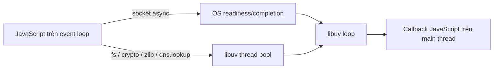

# libuv, thread pool, non-blocking I/O, khi nào Node bị block

> Mức độ: ⭐⭐⭐ senior | Thời gian đọc: ~8 phút

## 1. Tóm tắt nhanh (TL;DR)

- Node.js runtime kết hợp V8 để chạy JavaScript và libuv để cung cấp event loop, async I/O, timer cùng một số tiện ích nền tảng.
- Network I/O thường dùng cơ chế non-blocking của OS; không phải mỗi socket đều chiếm một thread libuv.
- Thread pool mặc định của libuv (thường 4 worker) phục vụ một số thao tác như filesystem, `crypto`, `zlib` và `dns.lookup`; có thể tăng bằng `UV_THREADPOOL_SIZE` trước khi khởi động process.
- Callback JavaScript sau khi I/O hoàn tất vẫn chạy trên event loop thread. I/O bất đồng bộ không khiến callback JavaScript chạy đồng thời.
- CPU loop đồng bộ, serialization lớn, regex đắt hoặc callback dài đều có thể block event loop dù code dùng `async` ở nơi khác.

## 2. Khái niệm cốt lõi

libuv là thư viện C đa nền tảng, làm lớp trừu tượng cho event loop, polling I/O, timer, thread pool và process. Node.js không “chạy trên libuv” theo nghĩa libuv thay thế V8: V8 thực thi JS, Node cung cấp API/binding, còn libuv điều phối nhiều thao tác hệ thống.

Với socket TCP/UDP, OS có thể theo dõi hàng nghìn file descriptor bằng readiness/completion APIs (epoll, kqueue, IOCP…). libuv nhận tín hiệu socket có thể đọc/ghi, sau đó Node gọi callback JavaScript trên thread event loop. Mô hình này hiệu quả cho workload I/O-bound vì ít thread và ít context switch hơn mô hình thread cho từng kết nối.

Không phải API async nào cũng dựa trực tiếp vào OS async I/O. Một số thao tác không có cơ chế phù hợp, hoặc API cần hành vi đồng nhất giữa nền tảng, được thực thi trong thread pool. Ví dụ phổ biến: `fs` async, `crypto.pbkdf2`, `crypto.scrypt`, `zlib` và `dns.lookup`. `dns.resolve*` thường dùng DNS network query khác với `dns.lookup`, vì vậy khác nhau về thread pool và semantics hệ thống.



Thread pool dùng chung trong process. Một tác vụ nặng có thể làm các tác vụ khác chờ, kể cả khi chúng thuộc nhóm API khác cùng sử dụng pool. Tăng `UV_THREADPOOL_SIZE` có thể giúp throughput một số workloads, nhưng tăng CPU contention, memory stack và cạnh tranh I/O; nó không phải cách sửa event loop bị block bởi JavaScript.

## 3. Code ví dụ

Ví dụ chạy PBKDF2 bằng API async sử dụng libuv pool. Nó không chứa CPU loop so sánh và không phải mẫu lưu password: salt cố định chỉ dùng để minh họa scheduling.

```js
import { pbkdf2 } from 'node:crypto';
import { promisify } from 'node:util';

const deriveKey = promisify(pbkdf2);

async function main() {
	const startedAt = performance.now();
	const key = await deriveKey('secret', 'salt', 100_000, 32, 'sha256');
	console.log(`Key length: ${key.length}; elapsed: ${Math.round(performance.now() - startedAt)}ms`);

	// Tránh vòng lặp CPU-bound dài ở đây: nó chặn mọi callback trên event loop.
}

main().catch((error) => {
	console.error(error);
	process.exitCode = 1;
});
```

## 4. Trade-off & Best practices

- Chọn async APIs cho I/O trong server; nhưng giới hạn concurrency. Bắn hàng chục nghìn tác vụ `pbkdf2` cùng lúc có thể làm nghẽn pool và tăng latency của các API cùng dùng pool.
- Dùng semaphore/queue có giới hạn cho công việc nặng. Với CPU-bound work cần song song thực sự, dùng `worker_threads` hoặc process worker.
- Chỉ cấu hình `UV_THREADPOOL_SIZE` dựa trên profile, và đặt biến môi trường trước khi runtime khởi động. Benchmark cả latency tail và tổng throughput.
- Dùng `dns.lookup` khi muốn resolver semantics của hệ điều hành; cân nhắc `dns.resolve` nếu cần truy vấn DNS trực tiếp và semantics phù hợp.
- Tách theo dõi event-loop delay khỏi thời gian chờ pool: p95 request cao có thể do pool saturation dù event loop vẫn rảnh.

## 5. Lỗi thường gặp / Pitfalls

- Cho rằng “async” đồng nghĩa với chạy song song. Async chỉ nói caller không chờ đồng bộ; công việc có thể chạy OS, pool hoặc vẫn chạy trên main thread.
- Dùng `fs.readFileSync`/`execSync` trong request handler và kỳ vọng event loop vẫn phục vụ request khác.
- Tăng thread pool để chữa CPU-bound JavaScript. JS loop vẫn chiếm main thread, không chạy trong libuv pool.
- Quên pool có kích thước giới hạn và dùng chung: tác vụ crypto đắt có thể ảnh hưởng filesystem latency.
- Chỉ đo CPU tổng thể. Một core bão hòa có thể gây vấn đề lớn trong process Node dù CPU máy nhiều core vẫn thấp.

## 6. Câu hỏi phỏng vấn

<details>
<summary><b>Q1. libuv đảm nhiệm phần nào trong Node.js?</b></summary>

libuv cung cấp event loop đa nền tảng, polling I/O, timer, thread pool và một số abstraction cho process. V8 vẫn là engine thực thi JavaScript.

</details>

<details>
<summary><b>Q2. Network I/O có dùng thread pool không?</b></summary>

Thông thường socket I/O dùng polling/non-blocking facilities của OS thay vì một pool thread cho mỗi socket. Một số nhóm API như filesystem/crypto có thể dùng libuv pool.

</details>

<details>
<summary><b>Q3. Những API nào thường tranh chấp libuv pool?</b></summary>

Filesystem async, một số `crypto`, `zlib` và `dns.lookup` là các ví dụ thường gặp. Chi tiết phụ thuộc API/platform; hãy đo thay vì suy luận chỉ từ chữ “async”.

</details>

<details>
<summary><b>Q4. Tăng `UV_THREADPOOL_SIZE` có phải luôn tốt?</b></summary>

Không. Nó có thể tăng song song cho workload pool-bound, nhưng cũng tăng contention và tài nguyên. Chỉ đổi sau khi xác định pool saturation và benchmark trên tải đại diện.

</details>

<details>
<summary><b>Q5. Vì sao callback async vẫn có thể làm server chậm?</b></summary>

Callback được thực thi trên event loop thread. Nếu callback xử lý dữ liệu lâu hoặc đồng bộ, các callback khác phải chờ.

</details>

<details>
<summary><b>Q6. Phân biệt event-loop blocking và pool saturation thế nào?</b></summary>

Quan sát event-loop delay/utilization cùng CPU/profile và latency của từng nhóm API. Event loop rảnh nhưng các thao tác pool-backed chậm gợi ý pool saturation; callback CPU dài làm delay tăng.

</details>

## 7. Ứng dụng vào CV

- Chuyển xử lý CPU-bound khỏi request thread và giới hạn tác vụ crypto đồng thời, giảm p99 latency **[A]%** trong khi duy trì **[N] req/s**.
- Tối ưu cấu hình worker pool dựa trên profile production, rút ngắn thời gian xử lý batch **[A]%** mà không làm tăng p95 I/O latency quá **[B]%**.

## 8. Tài liệu tham khảo

- [Node.js: Don't Block the Event Loop](https://nodejs.org/en/learn/asynchronous-work/dont-block-the-event-loop)
- [Node.js API: `dns`](https://nodejs.org/api/dns.html)
- [Node.js API: `crypto`](https://nodejs.org/api/crypto.html)
- [libuv: Thread pool work scheduling](https://docs.libuv.org/en/v1.x/threadpool.html)

