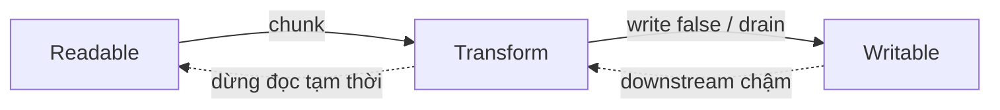

# Streams, Buffer, backpressure

> Mức độ: ⭐⭐⭐ senior | Thời gian đọc: ~8 phút

## 1. Tóm tắt nhanh (TL;DR)

- Stream xử lý dữ liệu tăng dần theo chunk thay vì bắt buộc nạp toàn bộ vào RAM; bốn loại chính là Readable, Writable, Duplex và Transform.
- `Buffer` biểu diễn vùng byte; `string` là văn bản đã giải mã theo encoding. Ranh giới chunk không bảo đảm khớp ranh giới ký tự.
- Backpressure là cơ chế downstream báo upstream giảm/tạm dừng tốc độ khi buffer đạt ngưỡng, giúp giới hạn bộ nhớ.
- Dùng `stream.pipeline()`/`node:stream/promises` để nối stream và xử lý lỗi/đóng tài nguyên nhất quán.
- `highWaterMark` là ngưỡng báo backpressure, không phải giới hạn cứng cho tổng bộ nhớ của toàn pipeline.

## 2. Khái niệm cốt lõi

Một Readable phát dữ liệu; Writable nhận dữ liệu; Duplex vừa đọc vừa ghi độc lập; Transform vừa đọc vừa ghi nhưng biến đổi dữ liệu. File I/O, HTTP request/response, compression và crypto thường tích hợp mô hình stream.

`Buffer` là abstraction cho byte, thường dùng để biểu diễn dữ liệu nhị phân. Khi nhận UTF-8 theo nhiều chunk, một ký tự có thể bị tách giữa hai chunk. Chuyển từng chunk bằng `chunk.toString('utf8')` có thể tạo ký tự thay thế ở ranh giới. Dùng `StringDecoder` hoặc `setEncoding('utf8')` để giữ trạng thái decode giữa các chunk.

Trong Writable, `write(chunk)` trả về `false` nghĩa là buffer nội bộ đã đạt hoặc vượt `highWaterMark` và producer nên dừng ghi đến khi có `drain`. Nếu bỏ qua tín hiệu này, producer nhanh có thể tiếp tục cấp dữ liệu, làm bộ nhớ tăng theo kích thước đầu vào. Khi stream downstream chậm, backpressure nên được truyền ngược qua pipeline để làm chậm nguồn.



Trong Node, `pipe()` chuyển dữ liệu và có xử lý một phần backpressure, nhưng quản lý lỗi giữa nhiều stream thủ công dễ thiếu sót. `pipeline()` nối các stream, forward lỗi và đóng các đầu liên quan khi thất bại. API Promise trong `node:stream/promises` phù hợp để phối hợp với `async`/`await`.

## 3. Code ví dụ

Ví dụ copy file theo stream, có backpressure, xử lý lỗi và giải phóng stream tự động. Dùng `node copy.mjs input.bin output.bin`; output phải chưa tồn tại (`wx`) để tránh ghi đè/truncate nhầm input.

```js
import { createReadStream, createWriteStream } from 'node:fs';
import { pipeline } from 'node:stream/promises';

const [, , source, destination] = process.argv;

if (!source || !destination) {
	throw new Error('Usage: node copy.mjs <source> <destination>');
}

try {
	await pipeline(createReadStream(source), createWriteStream(destination, { flags: 'wx' }));
	console.log('Copy complete');
} catch (error) {
	console.error('Copy failed:', error.message);
	process.exitCode = 1;
}
```

Không nên thay đoạn này bằng `readFile` rồi `writeFile` khi file có thể lớn hơn memory budget của process. Với transform tự viết, implement `_transform` và gọi callback đúng một lần; stream sẽ áp dụng backpressure khi transform downstream chậm.

## 4. Trade-off & Best practices

- Dùng stream khi dữ liệu lớn, đến từ network/file, hoặc cần bắt đầu xử lý trước khi toàn bộ payload có mặt. Với payload nhỏ và cần random access, đọc toàn bộ thường đơn giản hơn.
- Ưu tiên `pipeline` cho stream chain vì lỗi và cleanup rõ ràng. Với pipeline HTTP, đảm bảo lỗi được chuyển thành response phù hợp trước khi headers đã gửi.
- Chọn `highWaterMark` dựa trên kích thước chunk, latency và bộ nhớ; benchmark dưới tải. Ngưỡng lớn giảm số lần chuyển giao nhưng tăng memory footprint.
- Không gom stream thành Buffer/string chỉ để truyền cho bước tiếp theo; điều đó loại bỏ lợi ích streaming. Cũng giới hạn kích thước body từ client.
- Dùng byte mode cho dữ liệu nhị phân; dùng encoding-aware decoder cho văn bản. Không cắt Buffer tùy ý nếu cần giữ tính toàn vẹn record/UTF-8.
- Với dữ liệu record như NDJSON, parse theo dòng hoặc framing protocol; một chunk không tương ứng một message.

## 5. Lỗi thường gặp / Pitfalls

- Gọi `write()` liên tục dù trả về `false`, tạo queue lớn và có thể gây OOM.
- Bắt lỗi riêng ở một stream nhưng không theo dõi lỗi của các stream còn lại, khiến process treo hoặc tài nguyên không đóng.
- Giả định event `data` chứa trọn một JSON document hoặc một dòng. Chunk boundary là chi tiết vận chuyển, không phải boundary ứng dụng.
- Decode từng Buffer độc lập và làm hỏng UTF-8 multibyte character bị chia giữa các chunk.
- Dùng `Buffer.allocUnsafe()` rồi đọc vùng chưa khởi tạo; chỉ an toàn khi ghi đè toàn bộ vùng đó trước khi đọc.
- Đặt `highWaterMark` quá cao với nhiều kết nối đồng thời, khiến tổng bộ nhớ vượt budget dù từng stream trông hợp lý.

## 6. Câu hỏi phỏng vấn

<details>
<summary><b>Q1. Backpressure giải quyết vấn đề gì?</b></summary>

Giữ tốc độ producer phù hợp với consumer để dữ liệu chưa xử lý không tích tụ vô hạn trong memory. Writable báo `write() === false`; producer chờ `drain` hoặc dùng pipeline hỗ trợ flow control.

</details>

<details>
<summary><b>Q2. `highWaterMark` có phải giới hạn memory tối đa?</b></summary>

Không. Đây là ngưỡng để stream báo cần giảm tốc độ; memory còn phụ thuộc các stream trong chain, chunk hiện tại, concurrency và buffer ngoài stream.

</details>

<details>
<summary><b>Q3. Vì sao nên dùng `pipeline()` thay cho nhiều `pipe()`?</b></summary>

`pipeline` điều phối lỗi và cleanup toàn chuỗi tốt hơn, tránh bỏ sót error listener hay để stream khác tiếp tục chạy sau khi một khâu hỏng.

</details>

<details>
<summary><b>Q4. Buffer khác string thế nào?</b></summary>

Buffer chứa byte; JavaScript string là chuỗi UTF-16 code units, cần encoding khi chuyển giữa string và byte. Ranh giới byte không nhất thiết là ranh giới ký tự, nhất là UTF-8 multibyte.

</details>

<details>
<summary><b>Q5. Vì sao không parse JSON riêng trên mỗi `data` event?</b></summary>

Chunk có thể chỉ chứa một phần JSON hoặc nhiều record. Cần tích lũy có giới hạn hoặc dùng framing/parser streaming phù hợp.

</details>

<details>
<summary><b>Q6. Khi nào stream không phải lựa chọn tốt?</b></summary>

Với dữ liệu nhỏ, cần truy cập ngẫu nhiên hoặc nhiều thao tác cần toàn bộ document, buffering có thể ít phức tạp hơn. Cần so sánh memory, độ phức tạp và latency thực tế.

</details>

## 7. Ứng dụng vào CV

- Chuyển luồng export dữ liệu **[N] GB** sang pipeline stream có backpressure, giảm peak memory từ **[A] GB xuống [B] MB** và tránh OOM ở giờ cao điểm.
- Xây dựng Transform pipeline cho upload/validation/compression, tăng throughput **[A]%** trong khi giữ p95 latency dưới **[B] ms**.

## 8. Tài liệu tham khảo

- [Node.js Streams API](https://nodejs.org/api/stream.html)
- [Node.js Buffer API](https://nodejs.org/api/buffer.html)
- [Node.js: Backpressuring in Streams](https://nodejs.org/en/learn/modules/backpressuring-in-streams)
- [Node.js: `stream.pipeline`](https://nodejs.org/api/stream.html#streampipelinesource-transforms-destination-callback)
