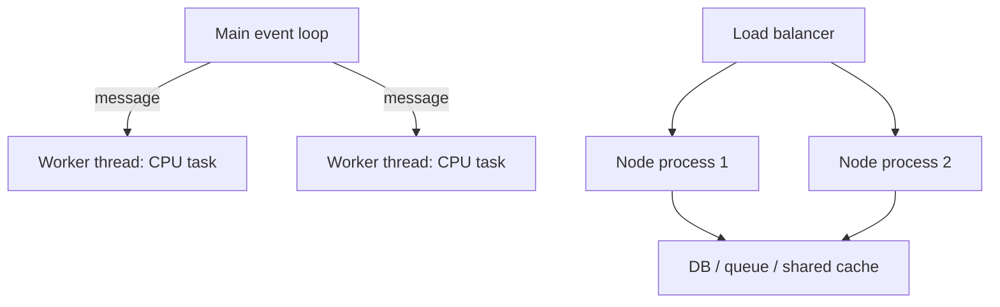

# Worker threads, child_process, cluster, scaling

> Mức độ: ⭐⭐⭐ senior | Thời gian đọc: ~8 phút

## 1. Tóm tắt nhanh (TL;DR)

- `worker_threads` chạy JavaScript trên thread riêng, phù hợp CPU-bound task; không nên tạo một worker cho mỗi request.
- `child_process` chạy executable/process riêng, cách ly bộ nhớ và hữu ích khi gọi tool bên ngoài hoặc cần process boundary.
- `cluster` tạo nhiều process Node có thể chia sẻ cổng server; mỗi worker có heap riêng, nên state trong RAM không được chia sẻ.
- I/O-bound code thường không cần worker thread; Node đã thiết kế event loop để multiplex I/O.
- Scaling cần bounded queue, health check, restart policy và telemetry; thêm worker không đảm bảo throughput nếu nghẽn DB, pool, CPU hoặc network.

## 2. Khái niệm cốt lõi

Một process Node thường có event loop và main thread JavaScript. `worker_threads` tạo thread với isolate V8 riêng, có thể chạy JS song song trên core khác. Worker giao tiếp bằng message (`postMessage`) có structured clone; dữ liệu lớn có thể chuyển ownership của `ArrayBuffer` hoặc dùng `SharedArrayBuffer`/Atomics. Shared memory tăng hiệu năng nhưng đòi hỏi đồng bộ hóa và dễ phát sinh race condition.

`child_process` tạo OS process. `spawn` phù hợp streaming stdin/stdout của chương trình dài; `exec` gom output vào buffer và chạy qua shell; `execFile` gọi executable trực tiếp, tránh shell parsing mặc định. Giới hạn `maxBuffer`, timeout và cách xử lý exit code cần được thiết kế. Không nối input không tin cậy vào command string.

`cluster` là mô hình nhiều process worker chuyên cho server workload. Các worker không chia sẻ heap; session, cache và khóa phải ở hệ thống ngoài process nếu cần dùng chung. `cluster` hữu ích trong một số deployment truyền thống, nhưng orchestrator/container hoặc process manager hiện đại thường scale bằng nhiều instance độc lập qua load balancer.



Worker có startup cost, heap riêng và overhead truyền dữ liệu. Vì vậy, pool worker có kích thước giới hạn thường phù hợp hơn tạo worker liên tục. Với task duration rất ngắn, overhead scheduling có thể lớn hơn lợi ích song song.

## 3. Code ví dụ

Hai file tối giản: `main.mjs` tạo worker; `cpu-worker.mjs` xử lý một task CPU-bound. Chạy bằng `node main.mjs`.

```js
// main.mjs
import { Worker } from 'node:worker_threads';

const worker = new Worker(new URL('./cpu-worker.mjs', import.meta.url), {
	workerData: 40,
});

worker.once('message', (result) => console.log({ result }));
worker.once('error', (error) => console.error('Worker failed:', error));
worker.once('exit', (code) => {
	if (code !== 0) console.error(`Worker exited with code ${code}`);
});
```

```js
// cpu-worker.mjs
import { parentPort, workerData } from 'node:worker_threads';

let total = 0;
for (let value = 0; value < workerData; value++) total += value;
parentPort.postMessage(total);
```

Trong production, đặt timeout/cancellation, xử lý message schema và dùng worker pool; ví dụ không nên được biến thành pattern tạo một worker cho mỗi request.

## 4. Trade-off & Best practices

- Chọn worker thread cho CPU-bound JavaScript có thể chia thành task độc lập; chọn child process khi cần isolation mạnh, executable ngoài hoặc crash boundary.
- Dùng `spawn` với stream khi output lớn; tránh `exec` với output không giới hạn vì dữ liệu được buffer trong memory.
- Dùng pool có bounded queue và áp dụng backpressure. Queue vô hạn chỉ chuyển overload thành memory leak/latency.
- Chuyển dữ liệu tối thiểu; transfer `ArrayBuffer` khi phù hợp để tránh copy. Dùng `SharedArrayBuffer` chỉ khi lợi ích đo được và synchronization được thiết kế kỹ.
- Scale service bằng process/instance stateless phía sau load balancer; externalize session và coordination. Theo dõi CPU quota trong container vì số core nhìn thấy có thể khác quota thực.

## 5. Lỗi thường gặp / Pitfalls

- Tạo worker mới trên mỗi HTTP request, làm startup, memory và context switching bùng lên.
- Chuyển cả object lớn nhiều lần qua structured clone, khiến serialization/copy trở thành bottleneck.
- Cho rằng cluster worker dùng chung biến global hoặc local cache; mỗi process có heap riêng.
- Dùng `exec` nối command và input không tin cậy, hoặc không giới hạn output/timeout.
- Tăng worker count vượt số CPU capacity, làm giảm throughput do contention.
- Không xử lý `error`, `exit`, timeout và cancellation nên task chết nhưng request chờ mãi.

## 6. Câu hỏi phỏng vấn

<details>
<summary><b>Q1. Khi nào chọn `worker_threads` thay vì async I/O?</b></summary>

Khi có tính toán CPU-bound JavaScript làm block event loop và task đủ lớn để bù overhead. I/O-bound task thường nên dùng API async thông thường.

</details>

<details>
<summary><b>Q2. Worker thread và child process khác nhau thế nào?</b></summary>

Worker có thread riêng/isolate V8 và có thể chia sẻ hoặc transfer một số memory; child process có OS process boundary và heap riêng, isolation mạnh hơn nhưng thường nặng hơn.

</details>

<details>
<summary><b>Q3. Vì sao nên dùng worker pool?</b></summary>

Giới hạn tài nguyên, tránh startup cho từng task và kiểm soát queue/concurrency. Pool cần cơ chế timeout, worker replacement và overload policy.

</details>

<details>
<summary><b>Q4. Cluster có chia sẻ memory không?</b></summary>

Không. Mỗi worker là process độc lập với heap riêng. State dùng chung cần lưu trong DB/cache/queue hoặc một hệ thống coordination phù hợp.

</details>

<details>
<summary><b>Q5. `exec` và `spawn` khác gì?</b></summary>

`exec` chạy shell command và buffer output; `spawn` tạo process với stream stdout/stderr, phù hợp output lớn hoặc process chạy lâu. `execFile` gọi chương trình trực tiếp không qua shell mặc định.

</details>

<details>
<summary><b>Q6. Có thể scale Node chỉ bằng tăng cluster worker?</b></summary>

Chỉ khi process là bottleneck và tài nguyên downstream còn đủ. Đo CPU, event loop, DB pool và network; tăng worker cũng tăng tổng connection và memory.

</details>

## 7. Ứng dụng vào CV

- Thiết kế bounded worker pool cho tác vụ xử lý ảnh, tăng throughput **[A]%** và giảm p99 API latency từ **[B] ms xuống [C] ms**.
- Tách service thành **[N]** process stateless sau load balancer, duy trì **[A] req/s** qua rolling restart với tỷ lệ lỗi dưới **[B]%**.

## 8. Tài liệu tham khảo

- [Node.js Worker Threads](https://nodejs.org/api/worker_threads.html)
- [Node.js Child Process](https://nodejs.org/api/child_process.html)
- [Node.js Cluster](https://nodejs.org/api/cluster.html)
- [Node.js: Don't Block the Event Loop](https://nodejs.org/en/learn/asynchronous-work/dont-block-the-event-loop)

